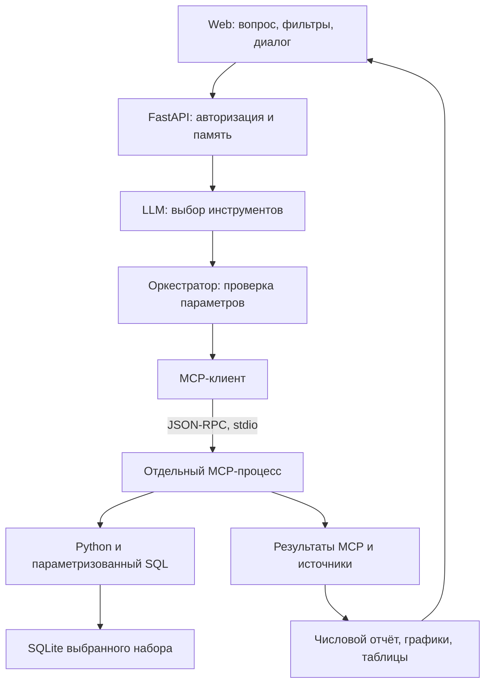

# RiskInsight — исследование кредитного портфеля

Учебное приложение для аналитика: **вопрос обычным текстом → выбор инструментов языковой моделью → настоящий MCP → расчёты Python/SQL → ответ, график, таблица и журнал источников**.

- Сервис: **https://riskinsight.onrender.com**. Развёрнутая версия проверяется отдельно от кода; `/api/health` показывает версию и `build_commit`.
- Исходный код: **https://github.com/dinatulyabaeva/riskinsight2.0**.
- Презентация: **https://riskinsight.onrender.com/presentation**; [HTML-файл](docs/presentation.html).
- [Соответствие замечаниям преподавателя](docs/TEACHER_CRITERIA.md), [фактические проверки поставки](docs/RELEASE_CHECK.md).

Для входа нужен `APP_ACCESS_TOKEN`, который владелец сообщает проверяющему отдельно. Это не ключ модели. Наличие ссылки и `HTTP 200 /api/health` сами по себе не подтверждают успешный анализ с живой LLM.

## 1. Задача, пользователь и границы MVP

**Пользователь:** аналитик кредитного риска. **Задача:** понять, скрывает ли улучшение общей доли просрочки ухудшение отдельного сегмента, проверить масштаб изменения и чувствительность учебных потерь к допущениям PD/LGD.

Рабочая последовательность:

1. Открыть тестовый портфель или импортировать учебный XLSX.
2. Запросить динамику DPD 90+ по доступным датам.
3. Уточнить продукт и регион в диалоге, сравнить траектории и вклады.
4. Открыть `[Tn]`, сверить числа, даты, фильтры и формулу.
5. Запустить условный стресс, сохранить отчёт и журнал.

Результат помогает выбрать сегмент для дальнейшего исследования. Причины поведения заёмщиков, эффективность взыскания и реальные будущие потери по этим данным установить нельзя.

**MVP:** агрегированные срезы, динамика, сравнение продуктов/регионов/рейтингов, DPD-корзины, арифметические вклады, стресс PD/LGD, качество данных, XLSX, графики по MCP и ограниченная память диалога. Свободный текст работает в пределах девяти реализованных инструментов. Неподдерживаемый запрос, неверные параметры или отказ провайдера дают явную ошибку.

**За границами:** произвольный SQL/код, индивидуальные кредитные решения, реальные банковские интеграции, прогноз риска, регуляторный NPL, IFRS 9 ECL, многопользовательская изоляция и гарантированная доступность 24/7.

Готовность к повторной сдаче требует автоматических проверок, свежего Eval выбранной живой модели и проверки опубликованной версии извне. Согласование задачи и оценка защиты принадлежат преподавателю; разработчик не может объявить их пройденными.

## 2. Тестовый датасет и сценарии

Нажмите **«Открыть тестовый портфель»**. Приложение валидирует и импортирует [portfolio-scenarios.xlsx](examples/portfolio-scenarios.xlsx), затем выбирает этот набор. Файл также можно скачать и загрузить обычным импортом.

**1 200 синтетических кредитов × 12 дат = 14 400 строк**, четыре продукта, три региона; даты **31.10.2025–30.09.2026**. На каждом срезе представлены те же кредиты, PD/LGD заполнены. Все траектории заданы открытыми правилами генератора и не описывают реальный рынок.

| Сценарий | Что видно в данных | Вопрос и визуализация |
|---|---|---|
| Локальное ухудшение | Потребительский / Приволжский: DPD90 **1,850267% → 24,530176%** | «Покажи тренд по потребительским кредитам в Приволжском регионе за весь период» → линия |
| Восстановление | Автокредит / Сибирский: **19,364827% → 3,847559%** | «А теперь только автокредиты в Сибирском регионе» → линия с сохранённым периодом |
| Стабильный сегмент | Ипотека: **1,967916%** на каждой дате, остаток уменьшается | «Покажи динамику по ипотеке» → отдельные графики доли и рублей |
| Разные меры риска | Ипотека даёт **59,449202%** остатка; максимальная доля DPD90 у другого продукта | «Сравни продукты по доле DPD90 и остатку» → столбцы и таблица |
| Общая доля скрывает сегмент | Портфель **3,970546% → 3,665629%**, несмотря на ухудшение потребительского продукта | «Покажи тренд и вклад продуктов в изменение» → линия и вклады |
| Условный стресс | PD ×1,5; LGD +5 п.п.; EAD фиксирован | «Как изменится EL при PD ×1,5 и LGD +5 п.п.?» → исходный/стрессовый EL |

[Паспорт датасета](docs/TEACHING_DATASET.md) содержит допущения и новые формулировки. [Контрольные результаты](examples/portfolio-scenarios.expected.json) рассчитаны независимо от SQL и LLM. Это эталоны проверки, а не сохранённые ответы модели.

Старый `builtin` сохранён: 10 000 кредитов × 12 срезов, seed = 42. Его суммы отличаются от нового XLSX. Во всех ответах указан фактический `dataset_id`.

## 3. Откуда берутся числа

На одной дате и в одной области фильтров:

**Доля DPD 90+ = сумма остатков кредитов с dpd ≥ 90 / сумма остатков всех кредитов.**

Для нового полного набора на 30.09.2026: **50 286 780 / 1 371 846 000 ≈ 0,03665629 ≈ 3,665629%**. Это доля задолженности, а не количества кредитов. В БД деньги хранятся целыми копейками; на выходе — рубли. Доли передаются в диапазоне от 0 до 1, графики показывают проценты. Разность долей выражается в процентных пунктах.

Учебный **EL = Σ(EAD × PD12 × LGD)**. EAD упрощённо равен остатку. Для нового набора на последнем срезе:

| Показатель | Рубли |
|---|---:|
| Исходный EL | 31 455 772,49 |
| Стрессовый EL: PD ×1,5, LGD +5 п.п. | 40 552 770,41 |
| Изменение | +9 096 997,92 |

Стресс считается по каждому кредиту: `min(1, PD × 1.5)` и `min(1, LGD + 0.05)`. Это условный сценарий с фиксированным EAD, не прогноз и не IFRS 9 ECL.

Разложение изменения: **Δ(w × r) = avg(w) × Δr + avg(r) × Δw**, где `w` — вес сегмента в остатке, `r` — доля DPD 90+ внутри сегмента. Сумма вкладов согласуется с общей разностью долей. Это арифметическая атрибуция, не доказательство причин. В новом наборе веса продуктов фиксированы: эффект структуры нулевой; это ограничение постановки.

Пустой знаменатель даёт `null`, не нулевой риск. Пропуски PD/LGD делают EL недоступным для соответствующей области; стресс отклоняется. Остатки разных дат нельзя складывать как поток выдач или платежей.

## 4. Архитектура и MCP



MCP стандартизует доступ к инструментам. В проекте отдельный процесс выполняет настоящие `initialize`, `notifications/initialized`, `tools/list`, `tools/call`. Транспорт — UTF-8 JSON-RPC по stdio, версия поддерживаемого поднабора **2025-06-18**. Это не обычная функция, переименованная в MCP. Совместимость отдельно проверяется официальным Python SDK.

Портфельные данные, включая дашборд, читаются через MCP. Импорт XLSX и начальное создание `builtin` — отдельные операции записи. Аналитические инструменты read-only.

| Инструмент | Назначение |
|---|---|
| `get_dataset_context` | Даты, категории, происхождение и ограничения |
| `get_portfolio_summary` | Остаток, DPD, EL, числитель/знаменатель |
| `get_delinquency_distribution` | Непересекающиеся DPD-корзины |
| `get_npl_trend` | Точки по датам, разность в п.п. |
| `analyze_segment` | Полное сравнение продуктов/регионов/рейтингов |
| `get_top_risk_segments` | Ограниченный рейтинг с порогом числа кредитов |
| `explain_npl_change` | Арифметические вклады сегментов |
| `run_stress_scenario` | Исходный/стрессовый EL и допущения |
| `check_data_quality` | Полнота, диапазоны, связи и целостность |

Схемы: [tool_registry.py](app/tool_registry.py), [экспорт JSON Schema](docs/mcp-tools.json). Ресурс: `riskinsight://methodology`. Поддерживаются необходимые проекту методы инструментов и ресурсов; полная реализация всех возможностей MCP не заявляется.

## 5. AI-логика, визуализации и память

В режиме `llm` каждый успешный анализ действительно обращается к настроенной модели. Сервер получает MCP-контекст, затем модель видит вопрос, допустимые даты/категории, схемы и ограниченную память. Она выбирает инструменты/параметры через **Tool Calling**. Оркестратор проверяет выбор и исполняет настоящие MCP-вызовы.

**Числовой текст и точки графиков формирует Python по результатам MCP.** Модель не генерирует JavaScript, SQL или точки. Успешный выбор обычно требует одного обращения к LLM; ошибочный выбор допускает до трёх попыток. Повтор одинакового вызова в одном анализе использует уже подтверждённый результат. Ошибка модели не переключает запрос в DEMO.

`provenance` сообщает, была ли вызвана LLM, какие инструменты исполнены по её выбору и кто сформировал текст. `mode=llm` не означает, что весь текст написала LLM. В этой архитектуре модель планирует анализ, а `narrative_source=mcp_renderer` обозначает программное форматирование источников.

Графики имеют текущий `[Tn]`, дату/период, набор, фильтры и единицы, рядом есть таблица. `null` остаётся пропуском. Минимум среди всех регионов нельзя определять по топ-N.

**Память:** до шести последних успешных вопросов/ответов и фактическая область анализа на сервере; до часа без активности. Она позволяет уточнить «а теперь по тому же периоду». Старые числа и `[Tn]` не становятся источниками нового ответа — MCP вызывается заново. Смена набора, даты, фильтров UI или «Новый анализ» сбрасывают контекст. После рестарта память отсутствует; сброс видим. Это память рабочей сессии, не обучение модели и не долговременная история.

## 6. XLSX и стабилизация данных

Один лист, заголовки в первой строке. Обязательные: `loan_id`, `as_of`, `product`, `balance_rub`, `dpd`. Опциональные: `region`, `risk_band`, `pd_12m`, `lgd`.

- До 10 МиБ и 100 000 непустых строк; неизвестные/повторные заголовки запрещены.
- Ключ `(loan_id, as_of)` уникален; тот же кредит на разных датах допустим.
- Остаток — число ≥ 0, максимум два десятичных знака; DPD — целое число ≥ 0; PD/LGD — от 0 до 1; рейтинг — A–D.
- Формулы, ошибки Excel, активное содержимое и некорректные значения отклоняются. При любой ошибке отклоняется весь импорт.
- Каждый импорт создаёт отдельную SQLite и `upload_<32 hex>`. Исходный XLSX сервер не сохраняет. UI выбирает успешный импорт автоматически.
- SHA-256 файла сохраняется в каталоге и источниках MCP. Вопросы не меняют версию данных. Повторное открытие неизменённого примера переиспользует импорт.
- Поставляемый синтетический XLSX определяется по байтам. Происхождение произвольных загрузок не подтверждается; `synthetic=false` не означает, что данные реальные или качественные.

На Render Free локальные файлы и память могут исчезать при рестарте, повторном развёртывании или засыпании сервиса. Пример восстанавливается из репозитория кнопкой открытия; свой файл нужно загрузить повторно. Сохранность загрузок на бесплатном локальном диске не заявляется.

Подробные диапазоны — [словарь](docs/DATA_DICTIONARY.md). HTTP-импорт: `POST /api/datasets/import?filename=portfolio.xlsx` принимает содержимое XLSX в теле запроса, не multipart. Токен защищает маршруты данных. Все держатели общего токена имеют доступ к наборам экземпляра; изоляция данных между пользователями не реализована.

## 7. Запуск и развёртывание

Python **3.11+**; Node.js для работы приложения не нужен. Docker использует Python 3.12. Секреты, базы и пользовательские загрузки не коммитятся.

### Windows PowerShell

```powershell
git clone https://github.com/dinatulyabaeva/riskinsight2.0.git
cd riskinsight2.0
py -3 -m venv .venv
.\.venv\Scripts\python.exe -m pip install -r requirements-dev.txt
Copy-Item .env.example .env
notepad .env
.\.venv\Scripts\python.exe -m uvicorn app.main:app --host 127.0.0.1 --port 8000 --workers 1
```

Замените `APP_ACCESS_TOKEN` своим случайным значением. `APP_MODE=demo` позволяет проверить фиксированные сценарии без модели с явной меткой DEMO. Для вопросов обычным текстом:

```dotenv
APP_MODE=llm
LLM_API_STYLE=openai
LLM_BASE_URL=https://openrouter.ai/api/v1
LLM_MODEL=inclusionai/ling-3.2-flash:free
LLM_API_KEY=ваш_приватный_ключ
APP_ACCESS_TOKEN=ваш_приватный_токен_входа
LLM_TIMEOUT_SECONDS=300
MAX_OUTPUT_TOKENS=2048
MAX_AGENT_ROUNDS=3
```

Доступность модели и квота зависят от провайдера. Автоматического перехода на платную модель нет. Переменные окружения процесса имеют приоритет над `.env`; безопасная проверка без ключа:

```powershell
.\.venv\Scripts\python.exe -c "from app.config import Settings; s=Settings.from_env(); print(s.mode, s.llm_api_style, s.llm_model, s.llm_base_url)"
```

Перезапустите сервер после изменения настроек. Адреса: `http://127.0.0.1:8000`, `/presentation`, `/api/docs`. Токен доступа вводится в окне приложения, ключ LLM остаётся на сервере.

Ollama также поддерживается: `LLM_API_STYLE=ollama`, `LLM_BASE_URL=http://127.0.0.1:11434`, имя установленной модели с tools. Качество/скорость конкретной модели требуют отдельного Eval. Результаты Qwen не переносятся на Ling.

Linux/macOS: `python3 -m venv .venv`, `source .venv/bin/activate`, далее те же Python-команды. Docker: `docker compose up --build`; локальный Compose хранит данные в именованном томе.

Render собирает Docker из GitHub. `render.yaml` задаёт бесплатный план; секреты `LLM_API_KEY` и `APP_ACCESS_TOKEN` вводятся в разделе **Environment** панели Render. Компьютер владельца не нужен для работы облачного OpenRouter. После развёртывания проверяются конкретный коммит, вход извне и настоящий вопрос к LLM. Проверки `/api/health` для этого недостаточно.

## 8. Проверки, Eval и разбор ошибок

| Проверка | Что доказывает | Чего не доказывает |
|---|---|---|
| Pytest | Контракты, формулы, ошибки, память, API, MCP | Качество живой LLM |
| SDK smoke | Совместимость stdio с официальным клиентом | Все возможности MCP |
| Controlled acceptance | Импорт, реальные MCP/SQL, ответы/графики и эталон при заданном выборе tools | Понимание текста живой моделью |
| Live Eval | Реальный выбор tools выбранной моделью на сохранённых вопросах | Универсальную точность на любых данных |
| Браузер / публичный сервис | UI, deploy и доступ извне | Постоянную доступность бесплатных платформ |

**Локальные результаты на 20 ноября 2026 года:** 225 тестов пройдено, 6 браузерных тестов пропущено, 1 предупреждение; время — 28,65 с. Контрольный прогон с заданными ответами провайдера: **34/34** анализов и **30/30** применимых графиков прошли сверку с независимым эталоном, ошибочных MCP-вызовов — **0**, внешних обращений к LLM — **0**. Это проверка интеграции, а не качества живой модели. [Вывод pytest](docs/examples/pytest-2.1.txt) и [контрольный отчёт](docs/examples/acceptance-controlled.json) сохранены.

**Открытые пункты:** свежий Eval живой модели на новой версии, проверка новой публичной сборки и подтверждённый успешный запуск GitHub Actions. До их выполнения проект не объявляется полностью проверенным. Подробности и ограничения проверки — [RELEASE_CHECK.md](docs/RELEASE_CHECK.md).

```powershell
.\.venv\Scripts\python.exe -m pytest tests -q
.\.venv\Scripts\python.exe -m compileall -q app scripts
.\.venv\Scripts\python.exe -m pip install -r requirements-sdk.txt
.\.venv\Scripts\python.exe -m scripts.sdk_smoke
.\.venv\Scripts\python.exe -m scripts.eval_acceptance --provider controlled --repeat 2 --output reports/acceptance-controlled.json
```

### Eval живой модели через опубликованный сервис

Этот способ проверяет именно сервер на Render. Локально нужен только **`APP_ACCESS_TOKEN` этого сервиса**; ключ `LLM_API_KEY` остаётся в настройках Render. Локальные настройки модели не определяют модель этого прогона.

Запускайте команды из обновлённой папки репозитория с той версией кода, которую развёрнули на Render. `git rev-parse HEAD` получает **полный 40-символьный SHA коммита**, а `--expected-commit` требует его точного совпадения с серверным `build_commit`. Если опубликована старая версия, проверка остановится до вопросов к модели. Ввод токена скрыт; не сохраняйте его в README или отчёте.

```powershell
$expectedCommit = (git rev-parse HEAD).Trim()
$serviceToken = Read-Host "APP_ACCESS_TOKEN сервиса Render" -AsSecureString
$env:APP_ACCESS_TOKEN = [System.Net.NetworkCredential]::new("", $serviceToken).Password
try {
    .\.venv\Scripts\python.exe -u -m scripts.eval_acceptance `
        --provider live `
        --base-url https://riskinsight.onrender.com `
        --expected-commit $expectedCommit `
        --repeat 1 `
        --max-llm-requests 40 `
        --output reports/acceptance-hosted-live.json
} finally {
    Remove-Item Env:APP_ACCESS_TOKEN -ErrorAction SilentlyContinue
    Remove-Variable serviceToken -ErrorAction SilentlyContinue
}
```

Прогон импортирует поставляемый синтетический XLSX через API, проверяет его хэш и даты, затем отправляет 17 вопросов, включая цепочку уточнений. Сохраняются фактическая модель, версия сервера, ответы, MCP-журналы и результаты числовой проверки. Внешние вызовы расходуют квоту настроенного провайдера. Бюджет ограничен 40 обращениями к LLM; перед каждым вопросом резервируются до трёх попыток планирования. При исчерпании бюджета или квоты в отчёте будет ошибка, а не успешный результат. Автоматического переключения модели нет.

### Eval живой модели из локального приложения

Без `--base-url` скрипт запускает анализ локально. Для этого отдельно должны быть настроены локальные `APP_MODE=llm`, модель и её ключ. Такой прогон не проверяет публичный сервис:

```powershell
.\.venv\Scripts\python.exe -m scripts.eval_acceptance --provider live --repeat 1 --output reports/acceptance-live.json
```

Отчёт сохраняет вопросы, ответы, параметры/результаты MCP, ожидаемые значения, проверку области, дат, чисел и графиков, ошибки, количество обращений к LLM и время. Для повторяемости выполните повторный прогон той же модели/данных. Использованные при доработке фразы — регрессионный набор, не независимый новый экзамен.

Эталон вычисляется отдельно с `Decimal` по исходным строкам, без SQL и `app.analytics`. Допуски: деньги 0,01 ₽, доли 1e-8, вклады 1e-6 п.п.; относительный допуск выключен. Существующий `[Tn]` сам по себе не доказывает корректность ответа.

### Ранее выявленные проблемы

| Проблема | Изменение |
|---|---|
| JSON вызова вместо ответа | Исполняются только структурированные `tool_calls`; ошибка выбора видима |
| Сводка заменяла ответ на другой вопрос | Удалены ранние специальные ветки исполнения; проверяется покрытие явно запрошенного анализа |
| Ошибки модели в рублях/миллиардах и формулах | Числа и формулы публикуются из MCP, не из свободного текста LLM |
| Метка LLM без обращения к модели | Явное `provenance`; успешный LLM-путь вызывает провайдера |
| Любой период сводился к шести месяцам | Валидируются запрошенные даты и число срезов |
| Уточняющий вопрос терял область | Серверная память и видимая область нового результата |
| После загрузки пользователь анализировал builtin | Автовыбор успешного импорта и явный ID |
| Повтор после обрыва создавал лишний запрос | Идентификатор запроса и ограниченный кэш успешного ответа |

Исторические «159 passed» и «18/20» относятся к прежнему коду/модели; они не являются оценкой этой версии. Свежие доказательства и неизмеренные пункты — [RELEASE_CHECK.md](docs/RELEASE_CHECK.md).

Браузерные проверки: установить `requirements-ui.txt`, выполнить `python -m playwright install chromium`, затем `RUN_BROWSER_TESTS=1 python -m pytest tests/test_browser.py tests/test_evidence_ui.py -q`. В PowerShell сначала `$env:RUN_BROWSER_TESTS="1"`. GitHub Actions содержит Windows/Linux и отдельные браузерные проверки; сам workflow ещё не означает успешный запуск.

## 9. Ограничения

Render Free засыпает после бездействия и имеет непостоянный локальный диск. Бесплатный OpenRouter имеет квоты и может вернуть 429/503. Приложение показывает ошибку и частичный MCP-журнал; не изображает успешный AI-анализ при отказе модели. Гарантированная работа 24/7 не заявляется.

Данные учебные, PD/LGD не откалиброваны, когорта упрощённая. Стресс не прогноз, вклад не причина, EL не резерв. Система не должна использоваться для индивидуальных кредитных решений. Не загружайте реальные персональные/банковские данные в общую учебную среду. Не публикуйте токены и пользовательские загрузки в Git.

## 10. Источники

- [MCP lifecycle](https://modelcontextprotocol.io/specification/2025-06-18/basic/lifecycle), [stdio](https://modelcontextprotocol.io/specification/2025-06-18/basic/transports), [tools](https://modelcontextprotocol.io/specification/2025-06-18/server/tools)
- [Официальный Python SDK](https://github.com/modelcontextprotocol/python-sdk)
- [OpenRouter Tool Calling](https://openrouter.ai/docs/guides/features/tool-calling), [Ling free](https://openrouter.ai/inclusionai/ling-3.2-flash:free), [лимиты](https://openrouter.ai/docs/api/reference/limits)
- [Render Free](https://render.com/docs/free), [Docker](https://render.com/docs/docker), [переменные окружения](https://render.com/docs/configure-environment-variables)

Формулы и условные правила генерации документированы в исходниках и [паспорте данных](docs/TEACHING_DATASET.md). Это методика учебного проекта, не банковский или регуляторный стандарт.
